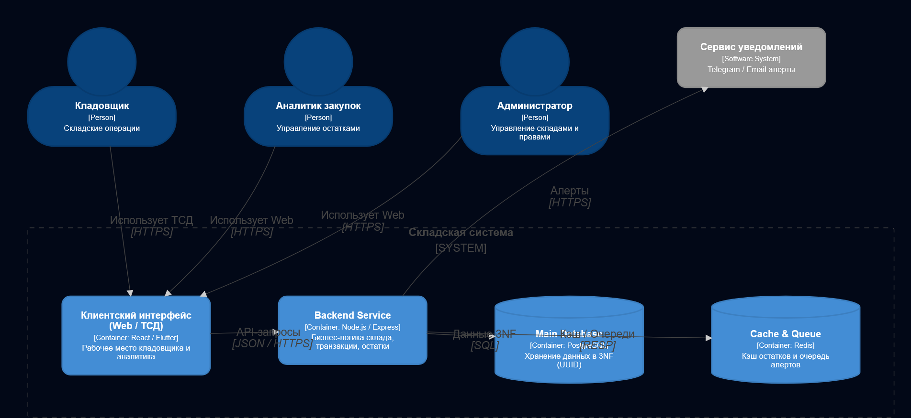
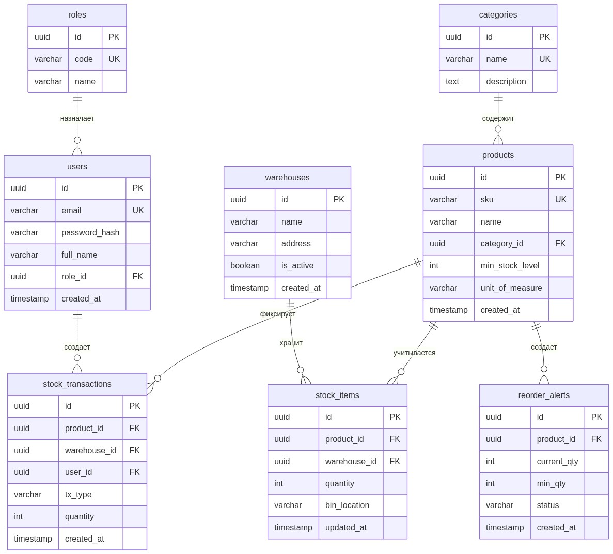

# Архитектурный отчет: Система учета складских запасов

**Дисциплина:** Разработка серверных приложений  
**Лабораторная работа №1:** Проектирование архитектуры серверного приложения и предметной области  
**Вариант №12:** Система учета складских запасов (*Inventory Management*)  

---

## 1. Описание проекта

**Проект:** Серверное приложение для учета товаров на складе (Inventory Management).

**Назначение системы:**  
Приложение предназначено для автоматизации рутинных складских процессов:
* Учет поступления товаров от поставщиков (приход) и отгрузки клиентам (списание).
* Адресное хранение — привязка остатков товаров к конкретным складам и ячейкам (`bin_location`).
* Контроль остатков — запрет списания больше, чем есть на складе (защита от отрицательных остатков).
* Автоматические оповещения (алерты) при снижении запаса товара ниже минимального порога (`min_stock_level`).
* Ведение журнала всех складских операций для истории и проведения инвентаризации.

---

## 2. Роли пользователей и сценарии использования (Use Cases)

В системе выделены три роли:

1. **Кладовщик:**
   * Принимает товар по накладным от поставщиков.
   * Отгружает и комплектует товар по заказам.
   * Перемещает товар между складами и ячейками хранения.
   * Проводит инвентаризацию (сверяет факт с базой и вносит корректировки).

2. **Аналитик закупок:**
   * Просматривает текущие остатки товаров на складах.
   * Задает порог минимального запаса для каждой позиции (`min_stock_level`).
   * Получает алерты о заканчивающихся товарах.
   * Оформляет заказы поставщикам на пополнение запасов.

3. **Администратор:**
   * Добавляет новые склады, категории и карточки товаров.
   * Регистрирует сотрудников и настраивает роли.

### Сводная таблица Use Cases

| ID | Роль | Сценарий (Use Case) | Что делает | Результат |
| :--- | :--- | :--- | :--- | :--- |
| **UC-1** | Кладовщик | Приемка товара | Вводит накладную, указывает склад и ячейку | Остаток увеличивается, запись в журнал (`RECEIPT`) |
| **UC-2** | Кладовщик | Отгрузка товара | Списывает товар под заказ клиента | Проверка наличия, уменьшение остатка, запись (`ISSUE`) |
| **UC-3** | Кладовщик | Перемещение | Переносит товар в другую ячейку или на другой склад | Атомарное обновление остатков, запись (`TRANSFER`) |
| **UC-4** | Кладовщик | Инвентаризация | Вводит фактический остаток при пересчете | Корректировка разницы, запись в журнал (`ADJUSTMENT`) |
| **UC-5** | Аналитик | Настройка лимита | Указывает минимальный порог остатка товара | Сохранение `min_stock_level` в карточке товара |
| **UC-6** | Аналитик | Просмотр алертов | Открывает список товаров, которые заканчиваются | Анализ дефицитных позиций |
| **UC-7** | Аналитик | Заказ поставщику | Формирует заявку на поставку нужного товара | Статус алерта переходит в `ORDERED` |
| **UC-8** | Администратор | Управление складом и каталогом | Создает склады, категории и новые товары | Обновление справочников системы |

---

## 3. Диаграмма C4 Containers (Уровень 2)

### Назначение компонентов

* **Клиентский интерфейс (Web / ТСД):** веб-приложение для аналитика и мобильный клиент Flutter для терминалов сбора данных со сканером штрихкодов.
* **Backend Service:** серверное приложение, где крутится вся логика склада (проверка, чтобы товар не списали в минус, запись операций, генерация алертов).
* **Main Database (PostgreSQL):** надежное хранилище всех таблиц в третьей нормальной форме (3NF).
* **Redis:** быстрый кэш для часто запрашиваемых остатков и очередь фоновых уведомлений.
* **Сервис уведомлений:** отправка сообщений аналитику в Telegram/Email, если товар подошел к концу.

---

## 4. Схема базы данных (ERD в 3NF)

Все таблицы используют первичные и внешние ключи формата **UUID** вместо обычных чисел (1, 2, 3), чтобы защитить систему от уязвимостей перебора ID и упростить генерацию записей.

### 4.1. Диаграмма сущностей (ERD)

### 4.2. Описание таблиц и полей

1. **`roles` (роли пользователей):**
   * `id` (`UUID`, PK) — идентификатор роли.
   * `code` (`VARCHAR(32)`, UNIQUE) — код роли (`STOREKEEPER`, `PROCUREMENT_ANALYST`, `ADMIN`).
   * `name` (`VARCHAR(64)`) — понятное название роли.

2. **`users` (сотрудники):**
   * `id` (`UUID`, PK) — идентификатор пользователя.
   * `email` (`VARCHAR(255)`, UNIQUE) — почта / логин.
   * `password_hash` (`VARCHAR(255)`) — хэш пароля.
   * `full_name` (`VARCHAR(150)`) — ФИО.
   * `role_id` (`UUID`, FK к `roles.id`) — привязка к роли.
   * `created_at` (`TIMESTAMP`) — дата создания.

3. **`warehouses` (склады):**
   * `id` (`UUID`, PK) — идентификатор склада.
   * `name` (`VARCHAR(100)`) — название склада.
   * `address` (`VARCHAR(255)`) — адрес.
   * `is_active` (`BOOLEAN`) — работает ли склад.
   * `created_at` (`TIMESTAMP`) — дата добавления.

4. **`categories` (категории товаров):**
   * `id` (`UUID`, PK) — идентификатор категории.
   * `name` (`VARCHAR(100)`, UNIQUE) — название (например, «Электроника», «Инструменты»).
   * `description` (`TEXT`) — описание категории.

5. **`products` (товары):**
   * `id` (`UUID`, PK) — идентификатор товара.
   * `sku` (`VARCHAR(64)`, UNIQUE) — артикул товара.
   * `name` (`VARCHAR(255)`) — наименование.
   * `category_id` (`UUID`, FK к `categories.id`) — ссылка на категорию.
   * `min_stock_level` (`INT`, CHECK `>= 0`) — минимальный остаток, ниже которого бьем тревогу.
   * `unit_of_measure` (`VARCHAR(20)`) — единица измерения (шт, кг, уп).
   * `created_at` (`TIMESTAMP`) — дата добавления.

6. **`stock_items` (остатки товаров по ячейкам):**
   * `id` (`UUID`, PK) — идентификатор записи.
   * `product_id` (`UUID`, FK к `products.id`) — какой товар.
   * `warehouse_id` (`UUID`, FK к `warehouses.id`) — на каком складе.
   * `quantity` (`INT`, CHECK `>= 0`) — количество (проверка на уровне базы: остаток не может быть меньше 0).
   * `bin_location` (`VARCHAR(32)`) — адрес полки/ячейки (например, «A-12-3»).
   * `updated_at` (`TIMESTAMP`) — время последнего изменения.

7. **`stock_transactions` (журнал всех операций):**
   * `id` (`UUID`, PK) — номер проводки.
   * `product_id` (`UUID`, FK к `products.id`) — товар.
   * `warehouse_id` (`UUID`, FK к `warehouses.id`) — склад.
   * `user_id` (`UUID`, FK к `users.id`) — кто провел операцию.
   * `tx_type` (`VARCHAR(32)`, CHECK `IN ('RECEIPT', 'ISSUE', 'TRANSFER', 'ADJUSTMENT')`) — тип операции (приход, расход, перемещение, ревизия).
   * `quantity` (`INT`) — сколько товара провели (+ приход, - расход).
   * `created_at` (`TIMESTAMP`) — точное время операции.

8. **`reorder_alerts` (алерты о заканчивающемся товаре):**
   * `id` (`UUID`, PK) — номер алерта.
   * `product_id` (`UUID`, FK к `products.id`) — дефицитный товар.
   * `current_qty` (`INT`) — сколько осталось сейчас.
   * `min_qty` (`INT`) — какой минимальный лимит.
   * `status` (`VARCHAR(32)`, CHECK `IN ('NEW', 'IN_PROGRESS', 'ORDERED', 'RESOLVED')`) — статус заявки.
   * `created_at` (`TIMESTAMP`) — когда сработал алерт.

### 4.3. Связи и нормализация (3NF)

* **Связь N:M («многие-ко-многим»):**  
  Один товар может лежать на разных складах, и на одном складе может быть много товаров.  
  В реляционных базах такая связь реализуется через связующую таблицу — у нас это **`stock_items`**. В ней хранятся внешние ключи `product_id` и `warehouse_id`, а также само количество товара `quantity` и адрес ячейки `bin_location`.
* **Почему схема находится в 3NF:**
  * **1NF:** все поля содержат простые неделимые значения (нет списков и массивов в ячейках).
  * **2NF:** у каждой таблицы есть первичный ключ `id`, и все данные зависят именно от него.
  * **3NF:** нет транзитивных зависимостей неключевых колонок. Например, адрес склада лежит строго в таблице `warehouses` и не дублируется в остатках `stock_items`. Название категории лежит строго в `categories`, а не пишется в каждый товар.

---

## 5. Ответы на контрольные вопросы

### 1. Чем отличается монолитная архитектура от микросервисной? Плюсы и минусы?
* **Монолит:** все приложение собирается в один проект, запускается одним процессом и работает с одной базой данных.
  * *Плюсы:* просто разрабатывать, легко тестировать и развертывать, надежные ACID-транзакции в рамках одной БД.
  * *Минусы:* тяжело масштабировать отдельные части системы; ошибка в одном модуле может уронить все приложение.
* **Микросервисы:** приложение разбито на несколько независимых сервисов, которые общаются по сети (REST, gRPC, очереди), и у каждого сервиса своя база данных.
  * *Плюсы:* сервисы можно обновлять и масштабировать отдельно друг от друга; сбой в одном сервисе не ломает другие.
  * *Минусы:* сложная настройка инфраструктуры, сетевые задержки при вызовах, сложно поддерживать согласованность данных между разными базами (распределенные транзакции).

### 2. Что такое 3-я нормальная форма (3NF) и зачем ей следовать?
* **Суть 3NF:** таблица находится во 2NF, и все её неключевые поля зависят напрямую только от первичного ключа, а не друг от друга.
* **Зачем нужна:**
  1. Убирает дублирование данных (экономит место).
  2. Защищает от аномалий:
     * *Аномалия обновления:* чтобы переименовать категорию товара, достаточно изменить одну строчку в таблице категорий, а не перезаписывать миллион товаров.
     * *Аномалия удаления:* удаляя остаток товара со склада, мы не удаляем саму карточку товара из каталога.

### 3. Какую роль выполняет слой бизнес-логики (Domain / Service layer)?
Служит мостом между запросами пользователя и базой данных:
* Проверяет бизнес-правила (например: *«нельзя отгрузить 10 штук, если на складе осталось только 5»*).
* Управляет сценарием операции: открыть транзакцию $\rightarrow$ списать товар $\rightarrow$ записать факт в журнал $\rightarrow$ проверить остаток и, если мало, создать алерт $\rightarrow$ закрыть транзакцию.
* Изолирует правила склада от конкретных веб-фреймворков и SQL-запросов.

### 4. Чем Container отличается от Component в C4 модели?
* **Container (Уровень 2):** это отдельно работающая программа, сервер или база данных, которая общается с другими по сети. Например: веб-сайт (SPA), мобильное приложение, Node.js бэкенд, база PostgreSQL.
* **Component (Уровень 3):** это внутренние части кода внутри одного контейнера. Например, внутри бэкенда: контроллер заказов, сервис склада, репозиторий работы с базой данных.

### 5. Разница между связями 1:N и N:M, и как сделать N:M в реляционной БД?
* **1:N (один-ко-многим):** одной записи соответствует много других (у одной категории много товаров). Делается добавлением внешнего ключа `category_id` в таблицу товаров.
* **N:M (многие-ко-многим):** один товар может быть на многих складах, а на складе лежит много товаров.
* **Как реализуется N:M:** напрямую такую связь СУБД не поддерживает, поэтому между ними создают промежуточную таблицу (у нас это `stock_items`). В ней указываются два внешних ключа (`product_id` и `warehouse_id`) и полезные данные (количество `quantity` и номер полки `bin_location`).
